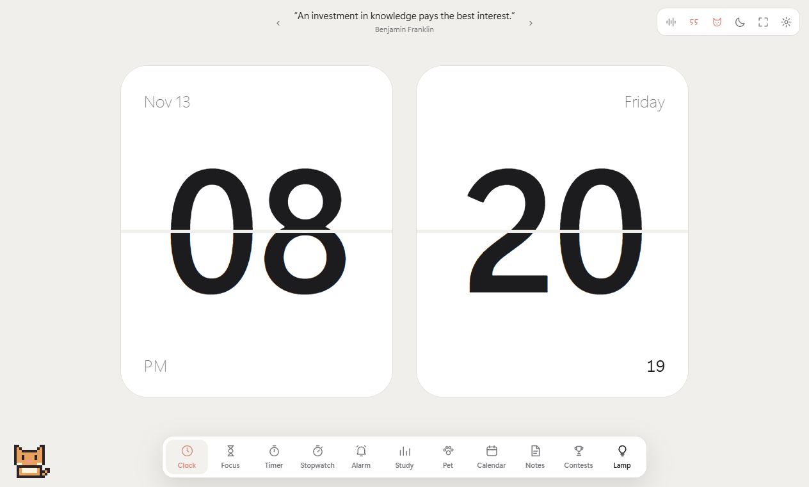
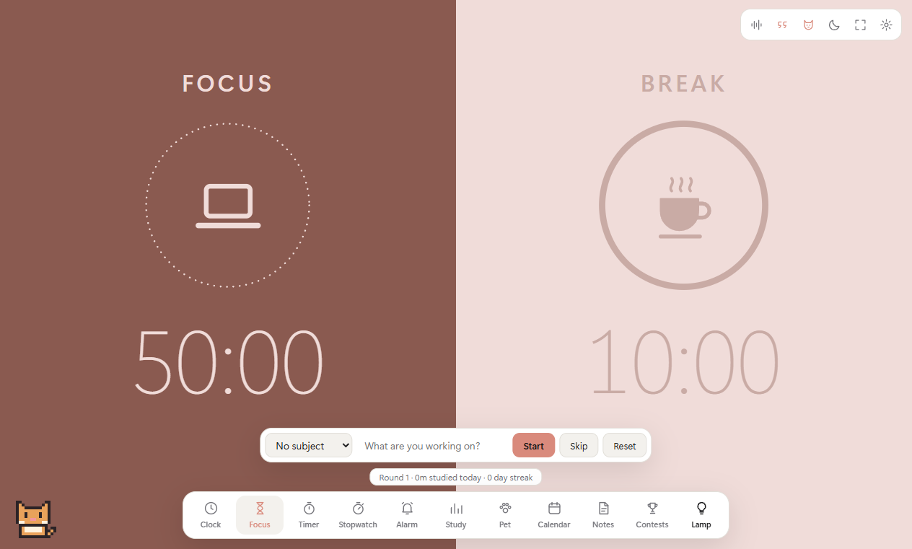
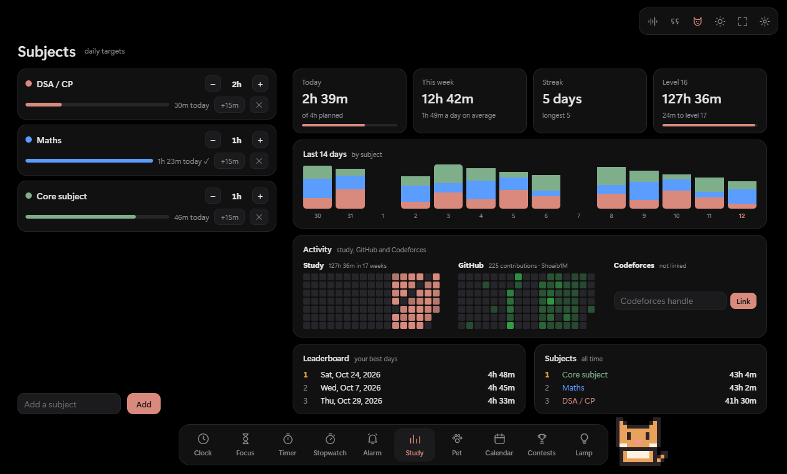
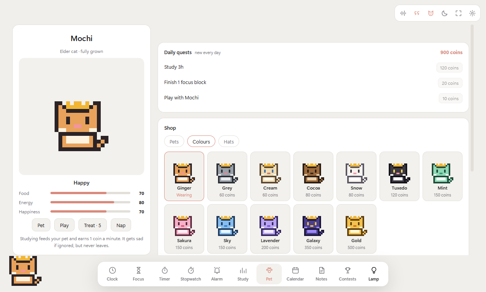
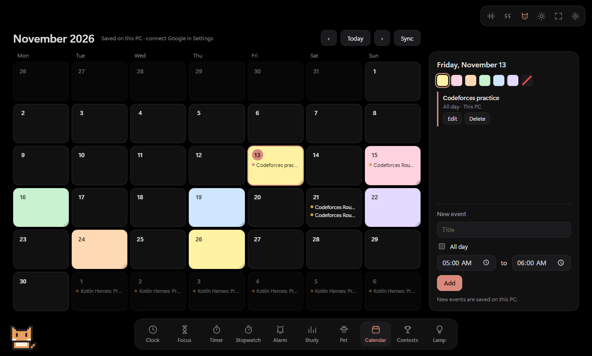
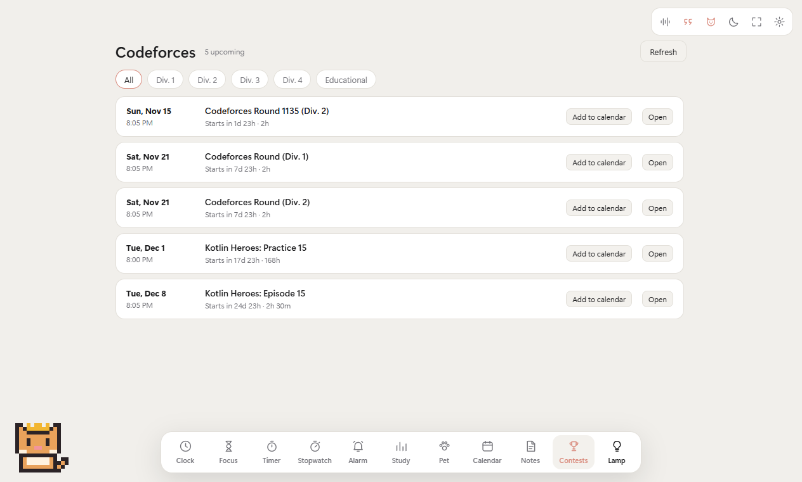
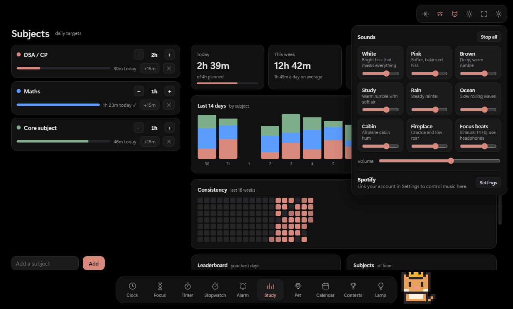
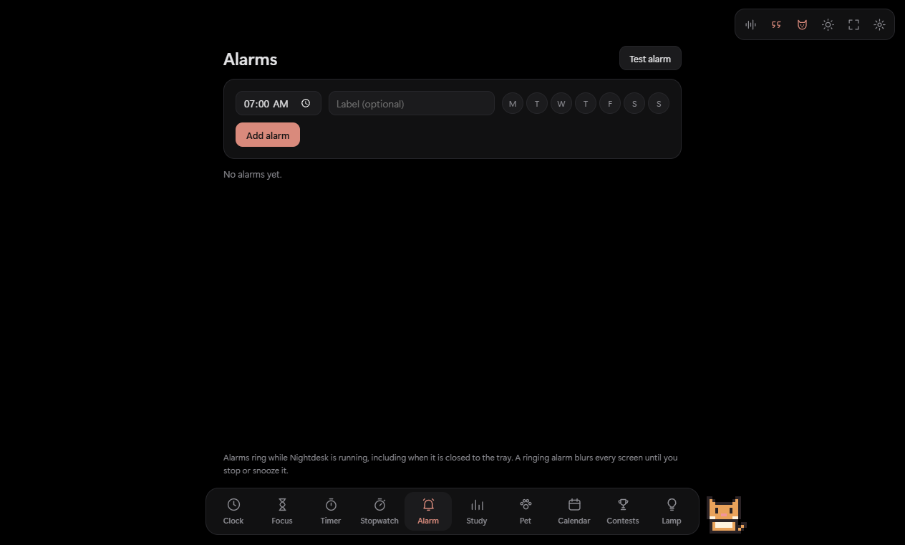
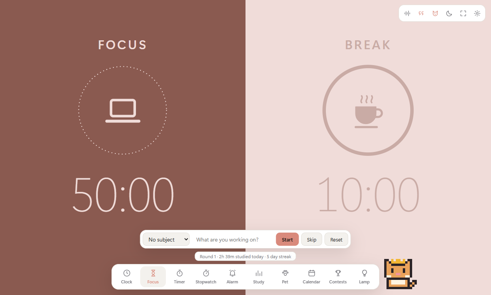
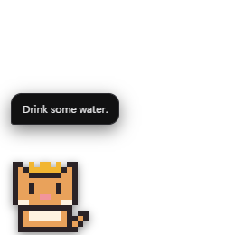

# NightDesk

A desktop study companion for Windows: flip clock, Pomodoro focus timer, alarms that take over the screen, study tracking per subject, a calendar, Codeforces contests, background sounds, a lamp mode for your second monitor, and a pixel pet that is fed by the time you actually study.

Everything runs and is stored locally. The only things that touch the internet are the ones that have to: Codeforces contests, new quotes, and (optionally) Google Calendar and Spotify.



## Features

| | |
|---|---|
| **Clock** | Split-flap clock that really flips (falling flap, bounce, shading, optional click sound) with date, weekday and seconds. Optional quote mode with a library that grows from the internet once a day. |
| **Focus** | Split focus / break Pomodoro (50 / 10 by default, long break every 4 rounds). Pick a subject and the time is logged to it. |
| **Timer / Stopwatch** | Countdown presets and custom times, laps. |
| **Alarm** | One-off or repeating alarms. A ringing alarm freezes and blurs every monitor with **Snooze** and **Stop**, like a phone. |
| **Study** | Subjects with a daily target you adjust with − / +, today / week / streak / level, a 14-day chart by subject, and side-by-side activity heatmaps for your study time, your GitHub contributions and your Codeforces submissions, plus a leaderboard of your best days. All on one screen. |
| **Pet** | A pixel pet with food, energy and happiness. Studying feeds it and earns coins. Daily quests, a shop (3 pets, 12 colour palettes, 5 hats), growth stages, break reminders, a start nudge, confetti for wins. Draggable, and can live on your desktop above other windows, walking along whichever monitor it is on. |
| **Calendar** | Month view with add, edit and delete. Double-click a day to fill it like a sticky note, or pick one of six pastel colours in the day panel; text stays readable on every colour. Local by default; two-way sync with Google Calendar once linked. |
| **Contests** | Upcoming Codeforces rounds with division filters, add-to-calendar and a reminder 30 minutes before. |
| **Lamp** | The whole window as one solid colour with presets, any custom colour and brightness. Made for using a second monitor as a light. |
| **Sounds** | Nine synthesised sounds you can layer: white, pink, brown, study, rain, ocean, cabin, fireplace, binaural focus beats. Spotify now-playing and controls once linked. |

Also: light and dark themes, five accent colours, fullscreen (F11), starts with Windows, and keeps running in the tray when closed so timers, alarms and sounds carry on.

## Screenshots

| Focus | Study |
|---|---|
|  |  |

| Pet and shop | Calendar |
|---|---|
|  |  |

| Contests | Sound mixer |
|---|---|
|  |  |

| Alarms | Light theme |
|---|---|
|  |  |

The desktop pet: 

## Getting started

Requires [Node.js](https://nodejs.org) 20 or newer and Windows 10 / 11.

```bash
git clone https://github.com/Shoaib1M/NightDesk.git
cd NightDesk
npm install
npm start
```

### Install it as an app

```bash
npm run install-app
```

This builds `Nightdesk.exe`, copies it to `%LOCALAPPDATA%\Programs\Nightdesk`, creates Desktop and Start Menu shortcuts, and launches it. The app registers itself to start with Windows (switch that off in Settings). To pin it, right-click its taskbar icon while it is open and choose **Pin to taskbar**.

Run the same command again after changing the code to update the installed copy.

## GitHub and Codeforces heatmaps

Type your GitHub username and Codeforces handle into the boxes on the Study tab (or in Settings). No sign-in or key is needed: NightDesk reads your public GitHub contribution calendar and your public Codeforces submissions, refreshes them every few hours, and keeps the last copy so the heatmaps still show offline.

## Optional accounts

Nothing here is required. Both are set up once in **Settings** (gear icon), and the credentials are stored encrypted on your PC, never in this repository.

### Google Calendar (two-way sync)

1. Open [console.cloud.google.com](https://console.cloud.google.com) and create a project.
2. **APIs & Services → Library** → enable **Google Calendar API**.
3. **Google Auth Platform** → set up the consent screen as **External** and add your own Gmail under **Audience → Test users**.
4. **Clients → Create client** → application type **Desktop app**.
5. **Audience → Publish app.** In *Testing* mode Google signs you out every 7 days; published, the connection lasts. When you sign in, Google warns the app is unverified: choose **Advanced → Go to the app** (it is your own app).
6. Paste the Client ID and Client secret into Settings and press **Connect**. They are saved, and if Google ever does sign you out, the Calendar tab shows a one-click **Reconnect**.

### Spotify (now playing and controls)

1. Open [developer.spotify.com/dashboard](https://developer.spotify.com/dashboard) and create an app (Web API).
2. Add this exact redirect URI: `http://127.0.0.1:43897/callback`
3. Paste the Client ID into Settings and press **Connect**.

Playback controls need Spotify Premium.

## Shortcuts

| Key | Action |
|---|---|
| `1` – `9` | Switch tab |
| `Space` | Start / pause on Focus, Timer and Stopwatch |
| `←` `→` | Previous / next quote on the Clock |
| `F11` | Fullscreen |
| `Esc` | Close a menu, leave fullscreen |
| `Enter` / `Esc` on a ringing alarm | Snooze / Stop |

## Tests

```bash
npm test
```

Runs the checks in `scripts/smoke*.js` inside the real app window on a throwaway profile: timers, alarms and snooze, calendar edge cases, study statistics, quotes, damaged saved data, the whole pet system, the desktop pet on every connected monitor, and the GitHub / Codeforces heatmaps. Some checks need an internet connection. Run one suite with `node scripts/run-tests.js smoke-pet.js`.

## How it is built

Electron with plain HTML, CSS and JavaScript. No framework and no runtime dependencies.

```
main.js            window, tray, start-with-Windows, alarm overlay, desktop pet window, IPC
preload.js         the small API the pages are allowed to call
gcal.js            Google Calendar sign-in (OAuth, PKCE) and API calls
spotify.js         Spotify sign-in (OAuth, PKCE) and playback API
src/
  index.html       the app page
  core.js          helpers, settings, navigation, Settings sheet
  time.js          clock, focus timer, countdown, stopwatch, alarms
  study.js         subjects, study log, statistics
  pet.js           pet care, coins, shop, quests, celebrations, dragging, roaming
  pet-sprite.js    pixel-art drawing shared with the desktop pet
  calendar.js      calendar and Codeforces contests
  sound.js         synthesised sound mixer and Spotify mini player
  lamp.js          lamp mode
  quotes.js        quote mode
  alarm.html       the full-screen "Alarm rang" window
  pet-desktop.html the desktop pet window
scripts/           icon generator, installer, tests
```

Sounds are generated with the Web Audio API and the pet is drawn pixel by pixel on a canvas, so the repository contains no audio or image assets apart from the screenshots above.

## Where your data lives

Everything (subjects, study log, calendar, alarms and snoozes, pet, coins, settings, the focus block in progress) is kept in a local SQLite database, `%APPDATA%Nightdesk
ightdesk.db`. Each change is written to disk the moment it happens (WAL journal, `synchronous=FULL`), so closing the app, ending it in Task Manager, shutting down or losing power does not lose anything.

**Backups, kept forever.** A copy is made every day (also while the app keeps running for days in the tray) into `backups/`, and a second copy goes to `DocumentsNightdesk Backups`. If Documents syncs to OneDrive, that copy also lives off the PC. Each copy is a few kilobytes, so years of them take almost no space.

**Self-repair.** If the database is ever damaged, the newest good copy is restored on start. If the whole app data folder is wiped (or you set up a new PC), NightDesk finds the copies in Documents and brings everything back.

**Undo.** Settings → Your data → *Restore a day* rolls everything back to any saved day; the state just before the restore is saved too, so a restore can itself be undone.

Errors are written to `%APPDATA%Nightdesk
ightdesk.log`, and a stray error never closes the app. Alarms that come due while the laptop sleeps ring when it wakes (up to an hour late, labelled "missed").

Google and Spotify tokens sit next to the database, encrypted with Windows' own credential protection. You enter them once; both renew themselves.

## Limits worth knowing

- Windows only (the installer script, start-with-Windows and the alarm overlay are written for it).
- Alarms ring only while NightDesk is running, including in the tray. They do not wake a sleeping PC, but one missed during sleep rings as soon as it wakes (up to an hour late).
- The leaderboard is personal: it ranks your own best days, not other people.

## License

[MIT](LICENSE)
